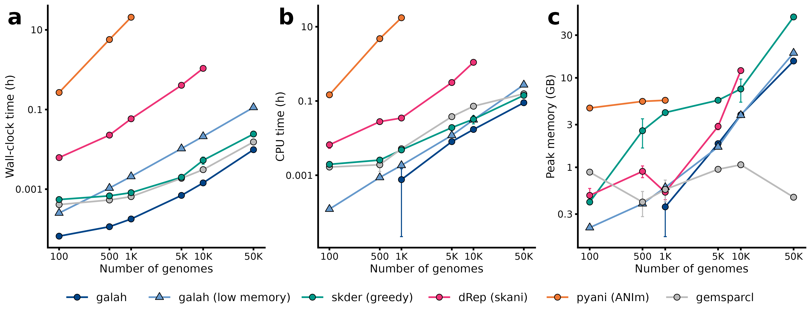
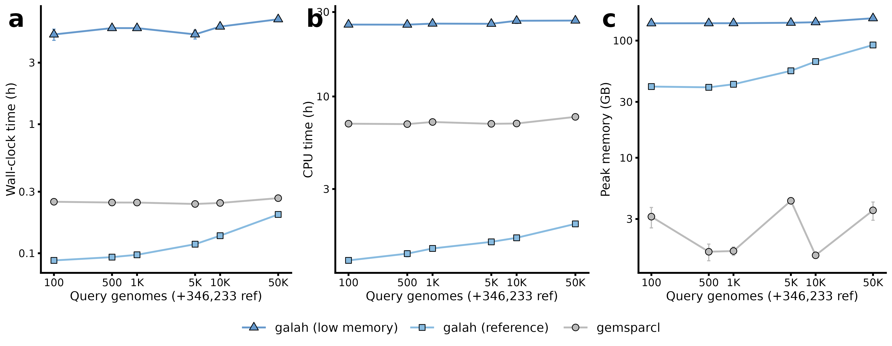
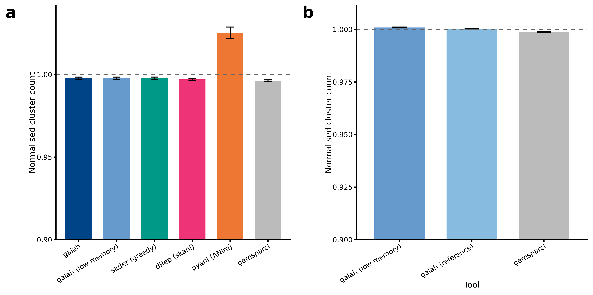

Why
========

# Why use Galah?

Metagenome-assembled genome (MAG) catalogues have grown from hundreds to hundreds of thousands of genomes.
Dereplicating a catalogue of this size (clustering genomes by average nucleotide identity (ANI) and picking one representative per cluster) is normally an all-vs-all comparison, which becomes impractical well before six-figure genome counts are reached.
Galah solves this issue through either a low-memory mode that avoids storing all pairwise comparisons in memory, solving the memory bottleneck, or by clustering against reference genomes instead of all-vs-all, avoiding the quadratic time complexity of pairwise comparisons entirely.

## Well-defined clusters

Generated cluster representatives have well-defined properties. If clustering at 95% ANI:

1. Each representative is \<95% ANI to every other representative.
2. Every member is \>=95% ANI to its representative.
3. If genome quality is available (e.g. from CheckM2), each representative has a better quality score than the other members of its cluster.

See the [Clustering](/#clustering) section of the docs for the full algorithm description.

## Benchmarking

We benchmarked galah against [skDER](https://github.com/raufs/skDER) (greedy clustering with skani), [gemsparcl](https://doi.org/10.64898/2025.12.30.695181) (MinHash ANI and nearest-neighbour graph clustering), [dRep](https://drep.readthedocs.io/) (using skani), and [pyani](https://github.com/widdowquinn/pyani) (ANIm) at 100, 500, 1,000, 5,000, 10,000 and 50,000 genomes, using 32 CPUs, 250GB memory, and a 48-hour walltime limit.

**Wall-clock time (a), CPU time (b) and peak memory (c) across catalogue sizes.** Points represent mean ± standard error of (a) total walltime, (b) CPU time, and (c) peak memory for each process. Jobs that exceeded either total RAM or walltime are not shown.

Only galah, gemsparcl and skDER completed the full range within 48 hours.
At 50,000 genomes, galah was faster (0.6 min, 15-16 GB) than both skDER (1.3-1.8 min, 47-50 GB) and gemsparcl (0.9 min, 0.4-0.5 GB), while gemsparcl used substantially less memory than either.
dRep became progressively slower and more memory-hungry (55-96 min and 10-14 GB at 10,000 genomes) and did not complete within 48 hours at 50,000 genomes, while pyani exhausted memory at 5,000 genomes and above.
galah's low-memory mode did not pay off at this scale: at 50,000 genomes it had both higher peak memory (18-19 GB) than galah's default mode and a longer runtime (6.7-6.9 min), suggesting any benefit would only emerge at genome counts beyond those tested here.

Note that galah's preclustering step (grouping genomes roughly by ANI before fine-grained comparison) was previously important for performance with the older FastANI backend, but is no longer necessary now that skani is the default comparison method — skani itself is fast enough that comparing all genome pairs directly is practical at these scales.

## Dereplicating against an existing catalogue

Growing a genome catalogue over time usually means re-dereplicating everything from scratch against the new batch of genomes.
Galah's `--reference-genomes` option instead lets new genomes be clustered directly against an already-dereplicated reference set: the new genomes are first dereplicated amongst themselves (so they don't need to be pre-dereplicated by the caller), and only the resulting representative(s) are then compared against the reference set - reference-vs-reference comparisons are never made, so only a small number of input-vs-reference comparisons are needed, rather than all-vs-all.

We benchmarked this by clustering 100 to 50,000 input genomes against all 346,233 genomes in [GlobDB](https://globdb.org/) r232 as reference genomes, comparing galah's low-memory mode (clustering the input genomes together with all reference genomes) against galah's `--reference-genomes` mode (clustering the new genomes against the pre-existing reference set) and gemsparcl.

**Wall-clock time (a), CPU time (b) and peak memory (c) when clustering against 346,233 reference genomes.** Points represent mean ± standard error of (a) total walltime, (b) CPU time, and (c) peak memory for each process. Jobs that exceeded either total RAM or walltime are not shown.

Only gemsparcl, galah in low-memory mode and galah in `--reference-genomes` mode completed the analysis; dRep exceeded the walltime limit, while skDER and galah's default mode exhausted available memory.
galah's `--reference-genomes` mode was the fastest (11-13 min and 89-93 GB at 50,000 input genomes), but gemsparcl required the least memory (16 min and 1.3-4.8 GB at 50,000 input genomes).
`--reference-genomes` mode was also substantially faster and required considerably less memory than galah's low-memory mode (372-408 min and 155 GB at 50,000 input genomes), because it greatly reduces the number of pairwise comparisons required.

## Consistency of cluster assignments

Cluster counts were fairly stable across tools in both benchmarks, with the exception of pyani, which uses a different clustering method and reported more clusters on average than the other tools (3% more, normalised by the mean across tools):

**Cluster counts, normalised by the mean across tools, for (a) the first benchmark and (b) the GlobDB reference-genome benchmark.** Points represent mean ± standard error.
In (a), galah, galah (low memory), skDER, dRep and gemsparcl agree to within a fraction of a percent. In (b), galah (low memory), galah (reference genomes) and gemsparcl are also highly consistent.

## Eukaryotic genomes

Metagenomes increasingly yield eukaryotic MAGs (primarily microeukaryotes like protists and fungi) alongside bacterial and archaeal ones, but dereplication and quality-assessment pipelines are typically built around prokaryotes only: completeness/contamination models trained on bacterial/archaeal marker genes, and MIMAG rRNA/tRNA criteria (5S/16S/23S) that don't apply to eukaryotic genomes.
Mixed-domain catalogues have generally had to be split by domain and run through separate tools before being recombined.

Galah instead classifies each genome's domain automatically with [isiteuk](https://github.com/wwood/isiteuk), then routes it to the appropriate tools: CheckM2, Barrnap and tRNAscan-SE (bacterial/archaeal mode) for Bacteria/Archaea, and [EukCC](https://github.com/EBI-Metagenomics/EukCC) with eukaryotic rRNA (18S/28S/5.8S) and tRNA criteria for Eukaryota.
Genomes with no confident domain assignment are assessed under all applicable domains, and the `--domain-choice` flag can override automatic classification when the domain is already known.
This means a single `galah process` run can dereplicate and quality-assess a catalogue spanning all three domains together, using one cluster ranking based on each genome's domain-appropriate quality score.

## One tool for dereplication and genome quality

MIMAG quality (completeness, contamination, rRNA and tRNA presence) is normally assessed with a separate set of tools before or after dereplication.
Galah's `process` subcommand runs both steps together: it determines MIMAG quality and uses it to choose the best representative of each cluster, then reports both the cluster definition and the MIMAG summary from a single invocation.

## Integration with CoverM

Galah's clustering is also available through [CoverM](https://github.com/wwood/CoverM)'s `cluster` subcommand, so read coverage/relative abundance calculation and genome dereplication can be run from the same toolset.
